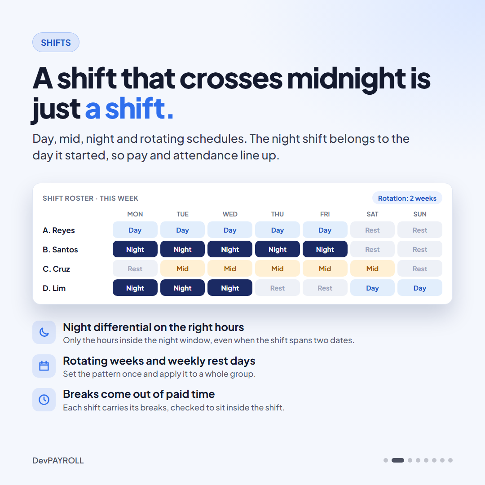
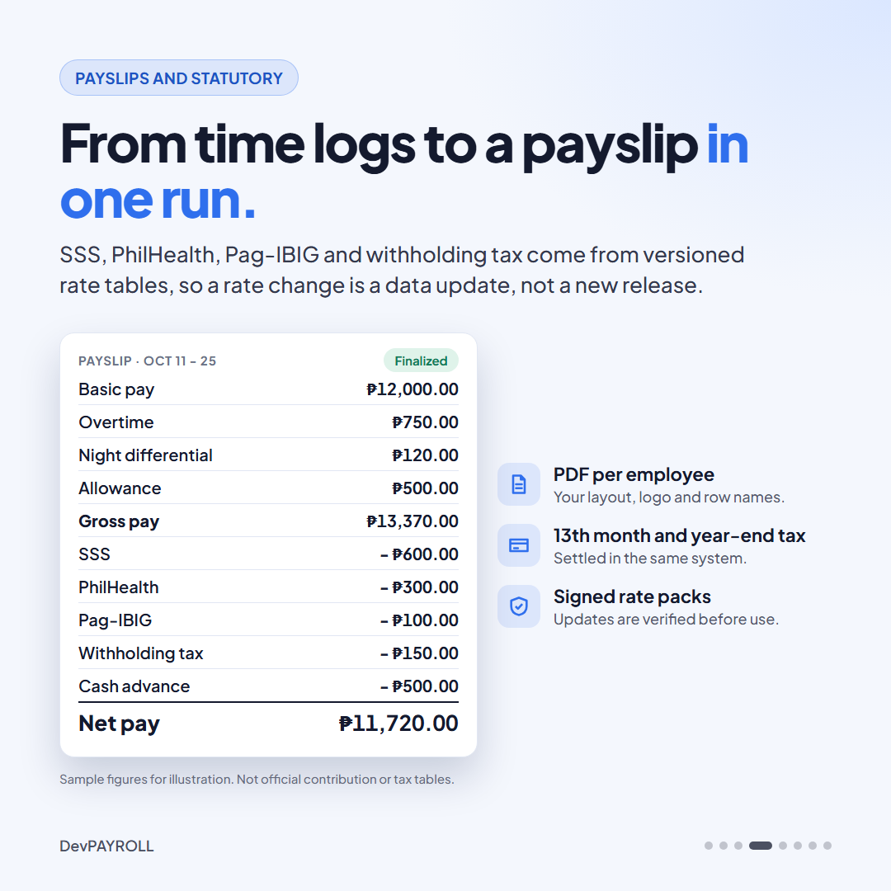
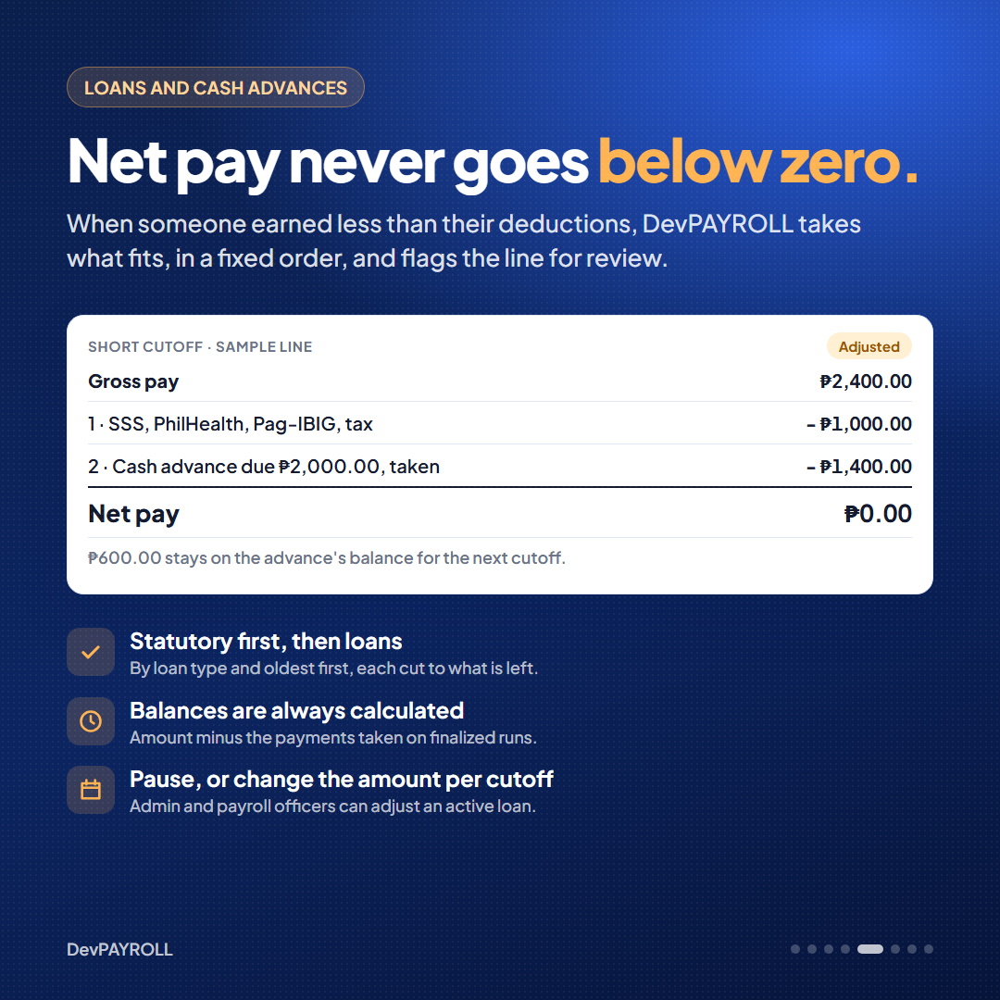
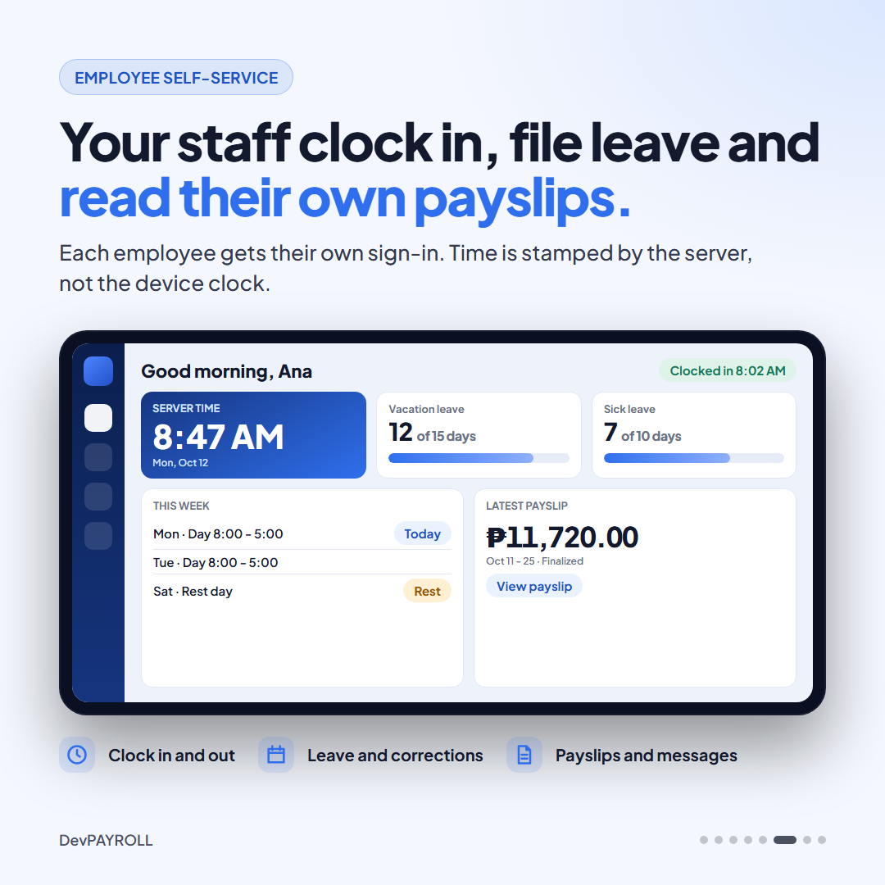

# DevPAYROLL: Multi-tenant Payroll for Philippine Companies

**A payroll system that gets night shifts, holidays and overtime right.**
It computes SSS, PhilHealth, Pag-IBIG and withholding tax, handles day, mid, night and rotating
shifts (including shifts that cross midnight), and gives employees their own sign-in for time
logs, leave and payslips. Built end to end as a single .NET codebase.

> The source code is private because this is a commercial product. I'm happy to give reviewers
> read access or walk through the code on a call, so feel free to reach out.

> Every name and amount in these images is made-up sample data. The peso figures are examples,
> not official government rates.

---

## Why I built it

Payroll in the Philippines is full of rules that are easy to get slightly wrong: night
differential only on the hours inside the night window, premiums that multiply instead of add,
holiday and rest-day rates that stack with overtime, contributions taken once a month, and a net
pay that must never go negative. DevPAYROLL is built around those rules, and it is meant to be
licensed to many companies, so every company's data is kept separate on the server.

## Screenshots

**Shifts**: day, mid, night and rotating schedules, with weekly rest days and breaks.

**Premium pay**: night overtime is 1.25 × 1.10, not 1.25 + 0.10.

**Payslip**: hours × rate on every earning, statutory deductions, loans, and a company-arranged layout.

**Loans and cash advances**: statutory deductions first, then loans, and net pay never below zero.

**Employee self-service**: clock in and out, leave balances, schedule and payslips.

**Dashboard and reports**: open time logs, pending approvals, and CSV/PDF reports.

## Features

### Time and shifts
- Shift definitions with breaks (overnight shifts included), checked so a break sits inside its shift
- Fixed or rotating weekly assignments with rest days, bulk assign, and a weekly roster
- Attendance entry, a quick-entry screen for a whole cutoff, and employee clock in and out stamped by the server
- Company and national holidays, with per-country calendars and per-branch holidays
- Time-log corrections with a required reason, and employee correction requests staff approve

### Pay
- Pay groups: weekly, semi-monthly or monthly, each computed on its own schedule
- Night differential, overtime, holiday and rest-day premiums, compounded the way the rules are
- SSS, PhilHealth and Pag-IBIG taken once a month, withholding tax by pay frequency
- Year-end tax settlement and BIR 2316 data, 13th month pay, allowances, bonuses, leave encashment
- Versioned statutory rate tables, updated through a signed rate pack, so a rate change is data and not a release
- Payslips on screen and as PDF from one model, with a layout each company arranges
- Government remittance exports (SSS, PhilHealth, Pag-IBIG, BIR) as CSV data files

### Loans and leave
- Salary loans, company loans and cash advances, taken until paid, never below zero net pay
- Leave types, credits and requests with half days, approvals, cancellation and payroll integration

### People and self-service
- Employee records with photos, a per-field change log, org structure and a manager's My Team page
- Own sign-in for employees, announcements with read tracking, private message threads
- Dashboard, reports in CSV and PDF, bell notifications, dark mode and adjustable text size

## Tech stack

| Area | Technology |
|---|---|
| API | ASP.NET Core minimal APIs (.NET 10), Identity, JWT bearer with rotating refresh tokens |
| Data | EF Core 10, SQL Server, global query filters for tenant isolation |
| Client | .NET MAUI Blazor Hybrid (Windows), Bootstrap 5.3, custom components |
| PDF | QuestPDF |
| Signing | ECDSA P-256 signed rate packs |
| Testing | xUnit: 400+ automated tests across the domain, data and API layers |
| Development | Visual Studio, GitHub, AI-assisted development with Claude Code |

## How it's built

- **Pure domain layer:** entities and the shift and pay calculators have no EF or ASP.NET
  references, so they are unit-tested on their own.
- **Multi-tenant by construction:** every tenant-owned entity is filtered by company in one place,
  and a dedicated test guards the filter against cross-company leaks.
- **Integer minutes, then hours once:** time is summed in whole minutes across records and
  converted to decimal hours a single time, so totals don't drift.
- **One model, two renderers:** the payslip is built once and drawn by both the PDF and the
  screen, so they can't disagree.
- **Rates are data, not code:** statutory tables are versioned rows with effective dates.

## About me

I'm **Mark Angelo Pasion**, a Senior Software Engineer from Malolos, Bulacan, with 10+
years of experience in C#, VB.NET, SQL Server, and SAP Business One integration.
DevPAYROLL is one of my own products, designed and built end to end.

- GitHub: [@arkienz](https://github.com/arkienz)
- See also: [DevPOS-Showcase](https://github.com/arkienz/DevPOS-Showcase)

Not affiliated with SSS, PhilHealth, Pag-IBIG (HDMF), BIR or DOLE.
